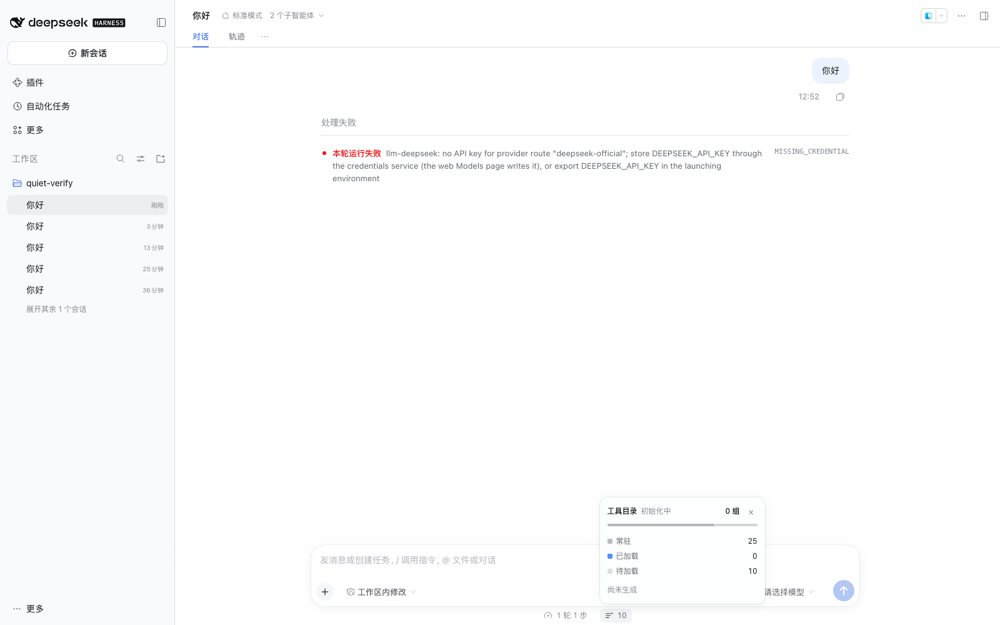

# Agentic Tool Catalog

**An agent builds and maintains the tool catalog: schemas stay out of context, tools load on demand.**



[English](README.md) | [中文](README.zh.md)

DeepSeek Harness normally sends every visible tool schema on every request. With many MCP servers and
extension plugins that gets expensive: context bloat, slower requests, and degraded tool selection once the
catalog grows past a few dozen tools.

Agentic Tool Catalog keeps a **directory** of deferred tools instead. A real DSH sub-agent reads the current
tool inventory, groups tools by intent, self-checks coverage, and returns a catalog. The plugin validates it,
caches it in **official DSH Storage**, and only ever sends a few lines of directory text — tools are loaded
by `search_tools` when a task actually needs them.

## What you get

- **Smaller requests**: deferred tool schemas never enter the context until loaded (measured 91 deferred
  schemas ≈ 109.6 KB ≈ ~27k tokens replaced by a 443-character directory note in this profile).
- **Agent-curated grouping**: groups are generated by an agent (not by name prefixes, not by a manual list):
  browser tools split by intent, Google tools split by product, cross-server capabilities merged.
- **Zero cooperation from other plugins**: no declarations, no metadata, no code changes. Any installed tool
  is discovered automatically.
- **Local-first**: the generator runs on your DSH model; no external service is required.
- **Reliable by design**: strict validation, one retry with feedback, single-flight generation, persistent
  cache (official `ctx.storageDomain`), incremental regeneration on catalog changes, and a visible
  "stale / refreshing" state if generation cannot complete. It always keeps working with the last successful
  catalog or a flat bootstrap directory — and never silently hides the failure.
- **Observable**: `catalog_status` exposes catalog freshness/origin, groups, loaded tools, generation and
  storage health.

## How it works

```
agent needs tools
  → tool catalog fingerprint (tool names + cache namespace)
  → hot cache / official Storage hit?  ── yes → use catalog
  → no: generate with a DSH sub-agent (incremental if a previous catalog exists)
        → validate (100% coverage, no duplicates, sane groups)
        → cache in official Storage + apply catalog (restriction releases tools on demand)
        → failure: retry once with error feedback; still failing → keep last successful grouping
          (status = stale, explicit warning + backoff retry) or flat bootstrap directory
```

- **New sessions** start generation immediately (pre-warm); **restored sessions** generate on their first
  user message/search; **catalog changes** regenerate immediately (incremental first).
- **Generation is keyed by the tool set, not by time**: one generation per unique tool fingerprint; the result is
  cached in official Storage and reused across sessions/restarts. There is no periodic refresh — the timestamp
  only moves when the tool set actually changes (install/remove a plugin or MCP server, preset change, etc.).
- Tools are hidden from the model with `agent.ctx.tools.restrict({ deny })`; `search_tools` releases them
  through DSH's native mid-conversation tool-addition path.
- The catalog cache lives in official DSH Storage (`ctx.storageDomain`, domain `agentic_tool_catalog`).
  If a profile has no storage service, the plugin falls back to memory-only caching (still functional;
  one regeneration after restart) and reports `storage.mode = "memory"`.

## Model-facing tools

| Tool | Parameters | Behavior |
|---|---|---|
| `search_tools` | `query: string`, `limit?: number` | Search the catalog by intent/keywords (name, description, group id/description). Exact group-name queries load the whole group (up to `groupMaxResults`). Loaded tools become callable for the rest of the session. |
| `catalog_status` | — | Read-only JSON: `catalog` (source/freshness/origin/total/groups/others), `session` (loaded/pending/restriction), `generation` (runs, cache hits, failures, retries, dedupe, stale uses, incremental runs, last error/ok, instance), `storage` (mode/state), `warnings`. |

A short `catalog:note` system-prompt section lists deferred groups and counts; during bootstrap/stale states it
adds one explicit line explaining that the catalog is initializing/refreshing.

## Configuration

```yaml
- id: agentic-tool-catalog
  name: 'dsh-agentic-tool-catalog'
  config:
    maxResults: 6            # tools loaded by one generic search
    groupMaxResults: 30      # tools loaded by an exact group-name search
    promptNote: true         # inject the catalog:note system-prompt section
    resident: []             # override the built-in resident list (tool names/globs)
    extraKeepResident: []    # append globs that must always stay visible
    extraDeferred: []        # force globs to stay deferred
    catalogProvider: spawn   # DSH subagent provider used for generation
    catalogTimeoutMs: 120000 # per-generation timeout
    catalogResetNonce: ''    # cache namespace; change it to force regeneration
```

Most profiles need no configuration. New plugins/MCP servers are picked up automatically on the next catalog
change; if a tool must always be visible, add it to `extraKeepResident`.

## Install

Local development (this workspace):

```bash
# via the DSH plugin manager
dsh plugin --profile web add dsh-agentic-tool-catalog
# local development (this repository)
dsh plugin --profile web add /path/to/dsh-agentic-tool-catalog
# or, from a shell in the DSH checkout
dsh plugin add /path/to/dsh-agentic-tool-catalog
```

Published package: `dsh-agentic-tool-catalog` (npm). Requires DSH `0.2.2-rc.1` or later.

```bash
dsh plugin --profile web add dsh-agentic-tool-catalog
```

## Performance (A/B: with vs without)

Measured on 5 tasks × 2 independent sessions per arm, same model and tool surface (122 tools incl. Google
Workspace MCP), DSH 0.2.2-rc.1, `deepseek-flash`:

| Metric | without (all tools resident) | with this plugin | Change |
|---|---:|---:|---:|
| Task pass rate | 100% (10/10) | 100% (10/10) | equal |
| First-request tool schema (payload) | 122 tools / 131,390 chars | 31 tools / 21,877 chars | **−83.3%** |
| **First-request real prompt tokens** (usage) | **49,504** | **18,536** | **−62.6% / −30,968 per request** |
| Avg total tokens / session | 452,463 | 268,551 | **−40.6%** |
| Avg steps | 7.40 | 7.90 | +6.8% |
| Avg cost / session | $0.0112 | $0.0116 | +3.7% (≈flat) |
| Avg wall time | 37.0s | 33.3s | −9.9% |
| Avg `search_tools` calls | 0.10 | 1.30 | +1.2/session |

One-time catalog generation (background, cached in official DSH Storage) is excluded from these task metrics.
Full methodology and caveats: [`docs/benchmark.md`](docs/benchmark.md) · full data card: [`docs/data-card.md`](docs/data-card.md).

## UI (minimal, read-only)

An icon + a small on-demand-tool count sits in the official composer dock (hover shows the catalog summary and
uses the same hover treatment as the official context meter). Click it for a read-only panel modeled on the
official ContextMeter: a segmented bar plus three rows (always available / loaded / on demand), a status dot and
freshness word, and one meta line (groups · storage · updated). There is no directory dump, no configuration, and
no long explanatory copy. It uses official slots/theme tokens and follows the light/dark theme.

## Development & release

See [`docs/development.md`](docs/development.md) for the layered validation flow (link dev profile →
npm artifact → staging composition → `next` dogfood → `latest`).

## Verification

```bash
node scripts/verify-agentic-tool-catalog.mjs          # module/regression tests
node scripts/verify-agentic-tool-catalog-schema.mjs   # real dsh-tools/schemastery/storage-domain compile
node scripts/verify-presentation.mjs                 # presentation files (locale/icon/detail)
```

Benchmark methodology and data live in [`benchmark/`](../../benchmark/discovery/) and are summarized in the
plugin page / release data card (compare **with vs without** the plugin on the same tasks).

## Safety & privacy

- Everything runs locally: the catalog is generated by the configured DSH sub-agent; no external service is required.
- The cache contains only tool names/group descriptions and lives in official DSH Storage (`ctx.storageDomain`). It never
  contains credentials, prompts, message content or tool results; it is derived data that can be regenerated at any time.
- The UI status panel is read-only, same-origin, and scoped to the current session; it exposes no secrets.
- The plugin does not modify other plugins or install anything outside DSH's plugin system.

## Known limits

- The cache is derived data. Losing it costs one regeneration (tens of seconds once per catalog); it is not
  user data and is not migrated between storage backends.
- Cold start: the very first run has no catalog yet and starts with a flat bootstrap directory while the agent
  generates one in the background. Subsequent runs, restarts and catalog changes use the persisted/incremental path.
- Generation quality depends on the configured model; the plugin validates strictly and retries/falls back
  with a visible status, but it cannot make a bad grouping "correct" silently.
- No UI dashboard yet (`catalog_status` is the observable interface); tools only (skills are not part of the
  catalog). Scale beyond a few hundred tools is not benchmarked yet.
- Uses the public `tools.definitions/restrict` surface and the official `storageDomain` API; both are
  DSH-plugin-facing APIs subject to the usual `0.2.x` stability caveats.

## License

MIT.
