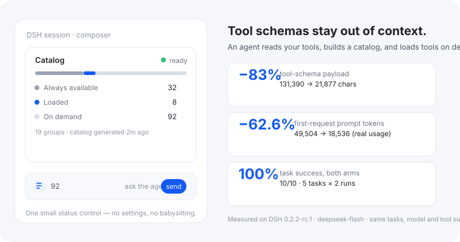
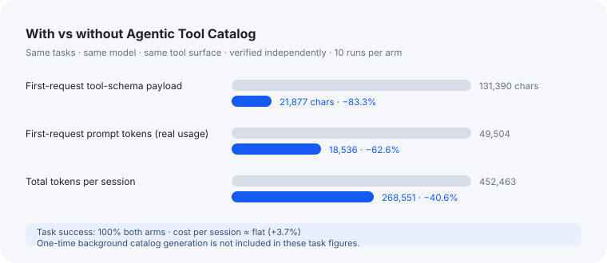

**All your tools. None of the context cost.**

Agentic Tool Catalog keeps a small, agent-built directory in context and loads tool schemas
only when a task needs them.

DSH normally sends every visible tool schema with every request. This plugin has a DSH
sub-agent organize your tools into a compact catalog — then only that catalog stays in
context, and `search_tools` loads the right tools on demand.

## What you get

- **A much smaller context** — in our A/B test the tool-schema payload dropped **83.3%** and
  the real first-request prompt dropped **62.6%** (about 31k fewer tokens per request).
- **No setup** — install a plugin or MCP server and the catalog regenerates when tools change.
- **Works with any tool** — plugin, MCP, or built-in; other plugins don't need to cooperate.
- **Local and private** — generated by your own model, cached in official DSH Storage.

Same tasks, same model, same tool surface; task success was 100% both with and without the
plugin. The catalog saves context, not by making tasks cheaper to run.

## Good to know

- Works with DSH `>=0.2.1-rc.2` or `>=0.2.2-rc.1`.
- v1 covers **tools**; native skills keep their normal behavior.
- The catalog is derived data and contains no messages, prompts, tool results or credentials.
- If a refresh fails, the last successful catalog stays active and retries; it never silently
  hides tools.
