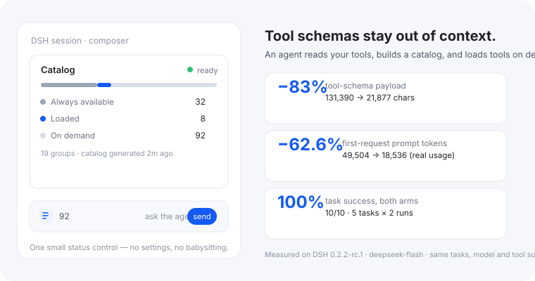
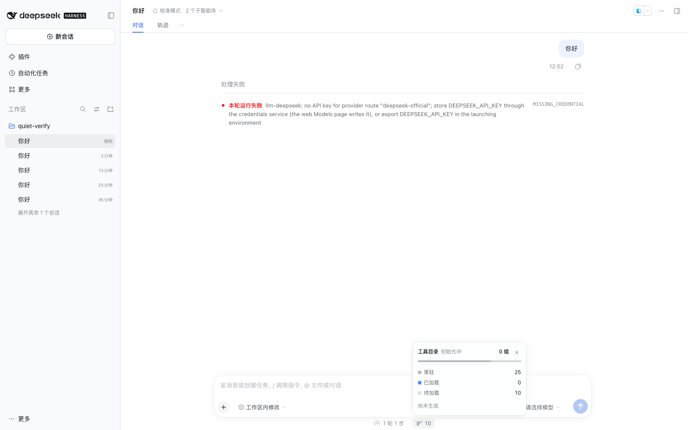
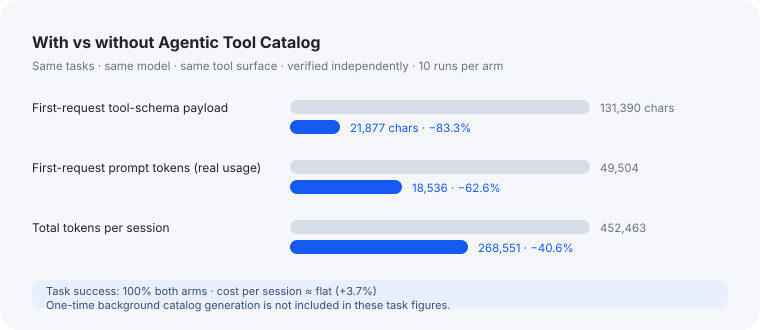

**由 Agent 生成并维护的工具目录。** 工具的 schema 默认不占上下文，真正需要时才加载。

DSH 默认会把每个可见工具的完整 schema 放进每一次请求。Agent 工具目录换一种做法：上下文里
只保留一份很小的目录。DSH 子代理读取当前工具清单、按用户意图分组，交回一份目录——这样你
保留全部工具，却不必在每次请求里背着所有 schema。

## 它能给你什么

- **更小的上下文**：延迟工具的 schema 在加载前不进请求。在我们的 A/B 实测中，工具 schema
  载荷下降 **83.3%**，真实首请求 prompt 下降 **62.6%**（每请求少 30,968 tokens）。
- **自动保持更新的目录**：新装插件或 MCP server，目录会在下一次变化时自动（增量）重建。
  不需要手工维护分组，也不需要别的插件做任何声明。
- **按意图找工具**：用日常语言描述需求，`search_tools` 找到合适的工具并为当前对话加载。
- **本地、私密**：目录由本机 DSH 模型生成，缓存进官方 DSH Storage；不需要外部服务。
- **可见但不吵**：输入框旁有一个只读状态控件，展示目录规模与新鲜度；设计上不需要你配置。

## 工作机制

1. **读取**——DSH 子代理读取当前可见工具清单（名称与描述）。
2. **组织**——按用户意图分组，并为每个组写一句简短说明。
3. **校验与缓存**——插件校验每个工具恰好出现一次，然后把目录缓存进官方 DSH Storage。
4. **按需加载**——上下文里只有目录；`search_tools` 在任务真正需要时加载对应工具。

如果生成没有完成，插件会继续使用上一次成功的目录，并明确显示状态与自动重试，而不是静默
隐藏工具。

## 在会话里看到的样子

控件就在官方输入框统计旁边：一个 glyph + 按需工具数。点击展开可以看到常驻 / 已加载 /
待加载数量、分组数，以及目录生成时间。

## 数据怎么说

同一批 5 个任务、同一模型、同一工具面，每臂 10 次独立运行；任务成功率两臂都是 **100%**。
它省的是上下文/tokens；单次会话成本基本持平（+3.7%），一次性后台目录生成成本不计入上述
任务指标。

## 它有什么不同

大多数按需工具插件是"检索优先""手动激活"或"人工维护目录"。Agent 工具目录是**目录优先**：
**目录结构由 Agent 读取工具后生成，并自动维护**。检索只是这个目录的入口，不是目录结构的来源。

## 你需要知道

- 适用于 DSH `>=0.2.1-rc.2` 或 `>=0.2.2-rc.1`。
- v1 覆盖 **tools**（含 MCP 与插件工具）；DSH 原生的 skills 仍使用它们自己的渐进披露机制。
- 目录是派生数据：丢了会重新生成；其中不包含消息、提示词、工具结果或凭据。
- 本页的开关用于启用/停用插件。没有需要你维护的设置表单——目录会自己更新；
  调试时仍可使用 `catalog_status`。
